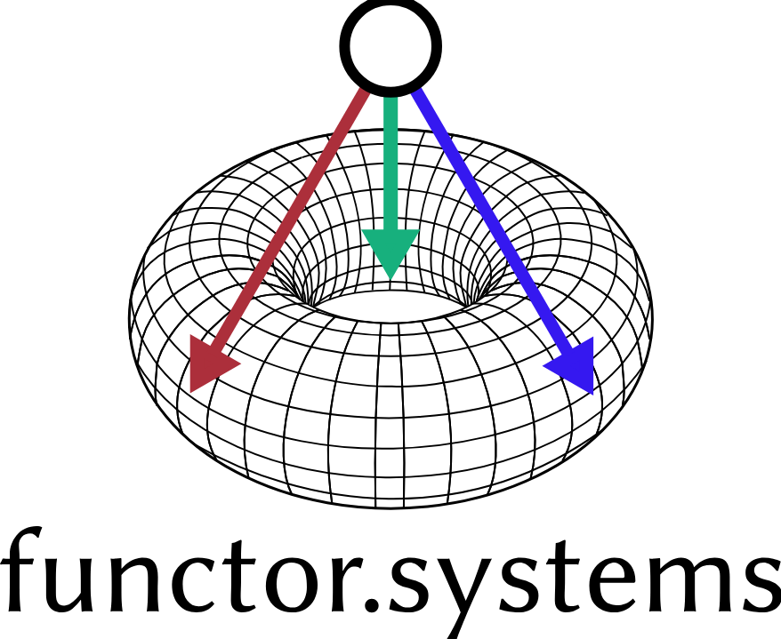

# identity

The visual identity of functor.systems

---

We are functor.systems, subtle and elegant, intellectual yet down-to-earth, and curiously irreverent. This repository contains [assets](assets) which best represent our organization and its members as a whole (a [homotopy-coherent](https://ncatlab.org/nlab/show/homotopy+coherent+diagram) collective, to be specific). There is also a [tarball](./functor-dot-systems.tar.gz) that packages these assets together nicely.

As an organization, we take our brand unseriously, and allow free modification of relevant assets, in accordance with the principles of [free as in freedom software](https://www.gnu.org/philosophy/free-sw.en.html) and [public intellectualism](https://en.wikipedia.org/wiki/Slavoj_%C5%BDi%C5%BEek). You are free to remix and redistribute the contents of this repository in accordance with the [CC BY-NC-SA license](./LICENSE), which forbids using these items for commercial purposes and requires appropriate attribution (a reference to [functor.systems](https://functor.systems) or [this repository](https://code.functor.systems/functor.systems/identity)).

## Insider details

The logo for our organization comes in two variants—one including only our graphical logo and one including both the logo and text below it that reads "functor.systems".

The primary graphical symbol of our organization depicts a limit point with three arrows pointing onto a [torus](https://en.wikipedia.org/wiki/Torus), the quintessential topological object of genus one. Each arrow represents a projection morphism, and the torus wireframe represents a partial wiring diagram of a [finite complete category](https://ncatlab.org/nlab/show/finitely+complete+category). Our logo is then the limit diagram of the corresponding [inclusion functor](https://ncatlab.org/nlab/show/full+subcategory), which embeds this category into a larger structure.

The font chosen for our wordmark is [Libertinus Sans](https://en.wikipedia.org/wiki/Libertinus), a free software Unicode typeface intended to counter the influence of common competing and proprietary typefaces. Forked from Linux Libertine, it traces its roots to the GNU/Linux free operating system. Its elegant letterforms communicate the intellectual flair of functor.systems.
