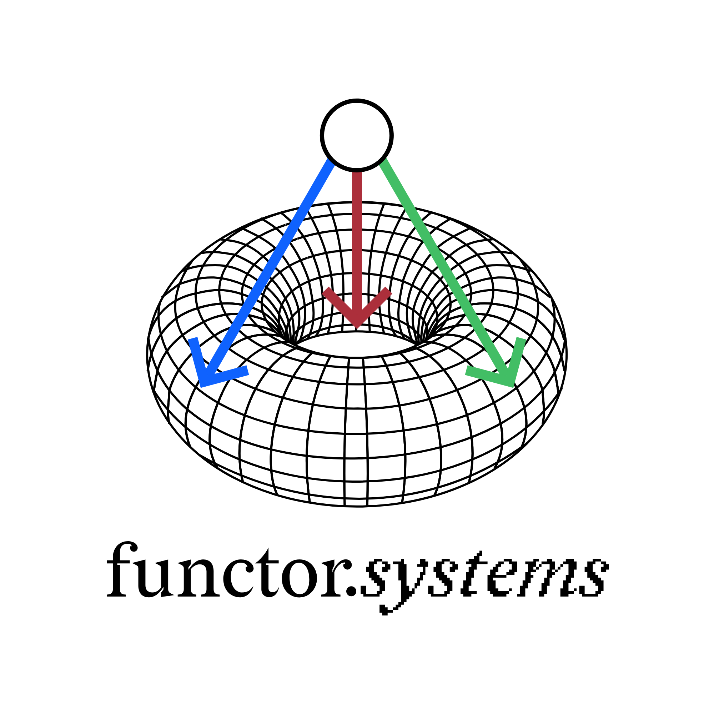
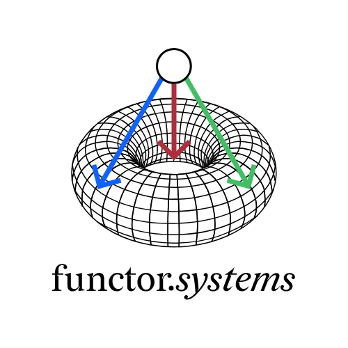
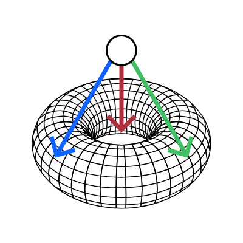
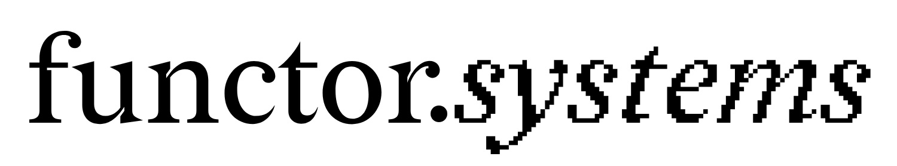
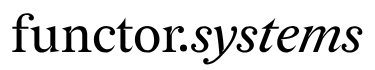

# identity

The visual identity of functor.systems

---

We are functor.systems, subtle and elegant, intellectual yet down-to-earth, and
curiously irreverent. This repository contains [assets](assets) which best
represent our organization and its members as a whole (a
[homotopy-coherent](https://ncatlab.org/nlab/show/homotopy+coherent+diagram)
collective, to be specific). Click to obtain a
[tarball](https://code.functor.systems/functor.systems/identity/archive/main.tar.gz) that packages these assets together
nicely.

As an organization, we take our brand unseriously, and allow free modification
of relevant assets, in accordance with the principles of [free as in freedom
software](https://www.gnu.org/philosophy/free-sw.en.html) and [public
intellectualism](https://en.wikipedia.org/wiki/Slavoj_%C5%BDi%C5%BEek). You are
free to remix and redistribute the contents of this repository in accordance
with the [CC BY-NC-SA license](./LICENSE), which forbids using these items for
commercial purposes and requires appropriate attribution (a reference to
[functor.systems](https://functor.systems) or [this
repository](https://code.functor.systems/functor.systems/identity)).

That being said, we still seek to maintain a consistent brand identity, even if you are free to modify it. Please review the [branding and identity guidelines](#visual-identity-and-brand-guidelines) below.

## Preview

<table>
<th>
    Hi-Res
</th>
<th>
    Lo-Res
</th>
<th>
    Graphic Only
</th>
<tr>
    <td></td>
    <td></td>
    <td></td>
</tr>
<tr>
    <td></td>
    <td></td>
</tr>
</table>

## Insider details

The logo for our organization comes in two variants—one including only our
graphical logo and one including both the logo and text below it that reads
"functor.systems". Our logos are designed in [Graphite](https://graphite.rs/)
and [Penpot](https://penpot.app/), free and open-source vector graphics
editors, and exported in SVG, PNG, and WEBP formats.

The primary graphical symbol of our organization depicts a limit point with
three arrows pointing onto a [torus](https://en.wikipedia.org/wiki/Torus), the
quintessential topological object of genus one. Each arrow represents a
projection morphism, and the torus wireframe represents a partial wiring
diagram of a [finite complete
category](https://ncatlab.org/nlab/show/finitely+complete+category). Our logo
is then the limit diagram of the corresponding [inclusion
functor](https://ncatlab.org/nlab/show/full+subcategory), which embeds this
category into a larger structure.

The font chosen for our wordmark is [Redaction](https://www.redaction.us/),
an OFL-licensed typeface. Its elegant letterforms communicate the intellectual
flair of functor.systems. In the high resolution variants, we use a bitcrushed
variant of Redaction on the _systems_ text. In low resolution versions, there
is no bitcrushing as it degrades readability.

## Visual identity and brand guidelines

Here we briefly describe a few rules for the use of functor.systems assets.

### Overview

As noted earlier

> ...as an organization, we take our brand unseriously...

However, unseriousness is no excuse for bad design. Do note that while you are
free to do as you wish with our assets, we still strive for a consistent visual
and typographic identity. As such, we establish a few basic rules for a
consistent functor.systems identity.

- In text, functor.systems should be stylized exactly as such, with the dot and exact capitalization. Do not write Functor.Systems, functor systems, Functor Systems, or any such variation. The only exception is in formal documents where such a stylized name is inappropriate, in such cases, and only such cases, use Functor Systems.
- When choosing variants of our logo or wordmark to display, ensure you choose the low-resolution and high-resolution variants appropriately. The high-resolution variant contains a stylized bitcrushed font variant that is unsuitable for low resolutions. As a rule of thumb, when targeting sizes below 500x500, use low resolution, and at sizes greater than 500x500, use high resolution. At 500x500, choose either at your discretion.
- The functor.systems wordmark is stylized functor._systems_. This stylization is a one-off typographic variation used exclusively in the wordmark. Do not use italicization a la functor._systems_ in text.
